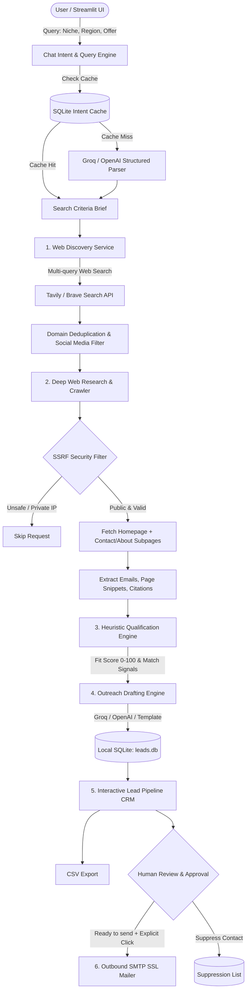

# 🔎 Client Finder

> **Local, Privacy-First Lead Research & Outreach Workspace**  
> Discover qualified B2B prospects, extract verified website evidence and published contact details, score fit deterministically, and draft personalized outreach — all stored in a local SQLite database with zero automated spam.

---

## 🌟 Overview

**Client Finder** is an autonomous yet human-in-the-loop research agent designed for freelancers, agencies, and B2B growth teams. Instead of relying on expensive, stale lead databases or blast-spamming bots, Client Finder searches live public web sources, crawls and verifies candidate websites, inspects About/Contact pages, extracts verified contact emails, scores prospect fit, and drafts tailored outreach grounded strictly in verifiable facts.

### Core Philosophy:
- **Evidence-Based:** Every detail, email, and snippet is tracked with its direct public URL citation.
- **Safety & Compliance:** Built-in SSRF protection prevents internal network scanning; strict human-in-the-loop controls prevent automated mass emailing; every outreach message includes compliant commercial disclosures and opt-out clauses.
- **Local & Private:** Leads, drafts, notes, and suppression lists stay in your local SQLite database (`data/leads.db`).

---

## 🏗️ Technical Architecture

Client Finder follows a modular, pipeline-driven architecture separating search discovery, defensive web crawling, qualification heuristics, LLM drafting, and local persistence.



---

## 🚀 Key Features

| Feature | Description |
| :--- | :--- |
| **Conversational & Structured Search** | Input criteria via chat or structured form (niche, location, launch signal, offer). |
| **Multi-Query Discovery** | Automatically generates 3 targeted query permutations through **Tavily Search** (default) or **Brave Search**, deduplicating candidate root domains. |
| **Defensive Web Crawling** | Inspects DNS records using `socket.getaddrinfo` to block SSRF attacks against private IP ranges (`127.0.0.1`, `10.0.0.0/8`, `192.168.0.0/16`, etc.). |
| **Contact & Evidence Extraction** | Crawls up to 3 contact/about pages per candidate to harvest published commercial emails, phone numbers, and verifiable website facts. |
| **Deterministic Fit Scoring** | Calculates an explainable 0–100 fit score based on category match, recency signals, published contact availability, and location match. |
| **Context-Grounded AI Drafting** | Uses **Groq** (`openai/gpt-oss-20b`), **OpenAI**, or deterministic fallback templates to write personalized cold emails strictly grounded in scraped evidence (insulated against prompt injection). |
| **Local Lead CRM** | Full pipeline management (`Needs review`, `Qualified`, `Ready to send`, `Contacted`, `Replied`, `Suppressed`), notes, and one-click CSV export. |
| **Compliance & Anti-Spam** | Enforces a global suppression list; email sending requires an explicit human click per message with mandatory sender postal address and opt-out instructions. |

---

## 📁 Project Layout

```text
client-finder/
├── app.py                            # Streamlit entrypoint (UI & tab routing)
├── requirements.txt                  # Python dependencies
├── .env.example                      # Environment variables template
├── .gitignore                        # Git ignore rules (.env, data/*.db, logs)
├── README.md                         # Project documentation
│
├── data/
│   └── leads.db                      # Local SQLite database (auto-created on first run)
│
├── scripts/
│   ├── setup.ps1                     # PowerShell virtual environment & dependency installer
│   └── run.ps1                       # Application launcher
│
└── client_finder/
    ├── __init__.py                   # Package exports
    │
    ├── core/                         # Core infrastructure & security
    │   ├── settings.py               # Application settings & environment loader
    │   └── security.py               # SSRF DNS inspection & URL validation
    │
    ├── services/                     # Business logic services
    │   ├── discovery.py              # Tavily & Brave web search with domain deduplication
    │   ├── research.py               # BeautifulSoup scraping, subpage crawling, email extraction
    │   ├── qualification.py          # 0-100 heuristic scoring engine & reasoning
    │   ├── drafting.py               # AI email generator (Groq/OpenAI) + template fallback
    │   ├── chat_intent.py            # Natural language query interpreter with SHA-256 caching
    │   └── workflow.py               # End-to-end orchestration workflow
    │
    ├── integrations/                 # External service adapters & storage
    │   ├── storage.py                # SQLite schema migrations, upserts, suppression list
    │   └── mailer.py                 # Secure SMTP email sender with legal footer injection
    │
    └── ui/                           # Streamlit UI tabs & components
        ├── tab_discover.py           # Conversational discovery form & live progress monitor
        ├── tab_pipeline.py           # Lead CRM table, inspector, editor, CSV export, SMTP sender
        ├── tab_suppression.py        # Do-Not-Contact list manager
        └── sidebar.py                # Environment-backed workspace configuration loader
```

---

## 🛠️ Step-by-Step Installation

### Prerequisites
- **Python 3.10+**
- A **Tavily Search API Key** ([tavily.com](https://tavily.com))
- A **Groq API Key** ([console.groq.com](https://console.groq.com)) *(optional, for AI drafting)*

### 1. Clone the Repository
```bash
git clone https://github.com/pavanchowdary-2612/client-finder.git
cd client-finder
```

### 2. Set Up Virtual Environment & Dependencies

**Windows (PowerShell):**
```powershell
Set-ExecutionPolicy -Scope Process Bypass
.\scripts\setup.ps1
```

**macOS / Linux:**
```bash
python3 -m venv .venv
source .venv/bin/activate
pip install -r requirements.txt
```

### 3. Configure Environment Variables

Create a `.env` file in the project root:
```env
# Web Search (Tavily is default; Brave is optional)
TAVILY_API_KEY=tvly-your-tavily-api-key
BRAVE_SEARCH_API_KEY=

# LLM Drafting (Groq is default; OpenAI is optional)
GROQ_API_KEY=gsk_your-groq-api-key
GROQ_MODEL=openai/gpt-oss-20b
OPENAI_API_KEY=
OPENAI_MODEL=gpt-6-astra

# Sender Identity (used for drafting signature and compliance footers)
SENDER_NAME=Alex Morgan
SENDER_BUSINESS=Apex Growth Studio
SENDER_EMAIL=alex@apexgrowth.example.com
SENDER_POSTAL_ADDRESS=123 Innovation Way, Suite 400, Austin, TX 78701

# Optional Outbound Email (SMTP over SSL, port 465)
SMTP_HOST=smtp.gmail.com
SMTP_PORT=465
SMTP_USERNAME=your-email@gmail.com
SMTP_PASSWORD=your-app-password
```

### 4. Run the Application

**Windows:**
```powershell
.\scripts\run.ps1
```

**Cross-platform:**
```bash
streamlit run app.py
```

The application will be live at **`http://localhost:8501`**.

---

## 🖥️ Demo Walkthrough & Results

### 1. Natural Language Discovery
In the **Find clients** tab, enter your criteria in plain English:
> *"Find recently launched sustainable clothing brands in India for our product photography agency."*

Client Finder automatically:
1. Translates the query into a structured brief (`Industry: clothing`, `Location: India`, `Launch: last 6 months`, `Offer: product photography`).
2. Dispatches 3 focused search queries across the web.
3. Deduplicates social networks and aggregates prospective domains.
4. Crawls homepages, About pages, and Contact pages to extract verified email addresses.

---

### 2. Sample Discovered Lead Card

```text
┌────────────────────────────────────────────────────────────────────────┐
│  Kala Cotton Collective  ·  Fit: 85 / 100  ·  Needs review             │
├────────────────────────────────────────────────────────────────────────┤
│  Website: https://kalaclothing.example.in                              │
│  Contact: contact@kalaclothing.example.in (Found on: /contact-us)      │
│                                                                        │
│  Verified Evidence:                                                    │
│  "Debuting our Summer 2026 organic handloom collection across India.   │
│  Crafted with artisan spinners in Gujarat."                            │
│                                                                        │
│  Why It Matched:                                                       │
│  ✔ Matches category terms: clothing, apparel                           │
│  ✔ Location appears in public evidence: India                          │
│  ✔ Public text contains launch signal: "Debuting our Summer..."        │
│  ✔ Published business email found on public page                       │
│  ✔ Website content was verified readable                               │
└────────────────────────────────────────────────────────────────────────┘
```

---

### 3. Generated Outreach Draft (Groq AI)

Client Finder prompts the LLM with strict safety boundaries and verified context:

```text
Subject: Apex Growth Studio × Kala Cotton Collective

Hi Kala Cotton Collective Team,

I came across Kala Cotton Collective while researching sustainable apparel brands in India 
and loved your debut Summer 2026 organic handloom collection.

I lead Apex Growth Studio. We specialize in high-conversion e-commerce product photography 
and lookbooks for emerging sustainable brands. Would a short preview of some creative 
directions for your collection be helpful?

Best,
Alex Morgan
Apex Growth Studio
alex@apexgrowth.example.com

If this isn't relevant, simply reply 'unsubscribe' and I will not contact you again.
123 Innovation Way, Suite 400, Austin, TX 78701
```

---

### 4. Lead Pipeline CRM & CSV Export

Switch to the **Lead pipeline** tab to manage your sales CRM:
- View status badges (`Needs review`, `Qualified`, `Ready to send`, `Contacted`, `Replied`).
- Edit lead notes, verified contact details, or customize the outreach draft.
- Download the full dataset as `client-finder-leads.csv` for use in your CRM (HubSpot, Notion, Airtable).
- One-click **Add to suppression list** to permanently block unwanted domains or addresses.

---

## 🔒 Safety, Privacy & Legal Compliance

1. **SSRF Guardrails:** Crawling arbitrary web URLs can expose local networks to Server-Side Request Forgery. Client Finder runs pre-request socket resolution to guarantee target IP addresses are globally routable internet addresses.
2. **Prompt Injection Defense:** Web scrapers frequently encounter malicious instructions planted in web text. Client Finder isolates scraped site content as raw data payloads in JSON and instructs the LLM to treat public site text purely as untrusted reference data.
3. **CAN-SPAM & GDPR Alignment:**
   - No automated bulk blasts: every message requires individual human authorization.
   - Every email automatically appends the physical postal address and explicit unsubscribe instructions.
   - One-click suppression stops future communication immediately.

---

## 📄 License

Distributed under the MIT License. See `LICENSE` for more information.
